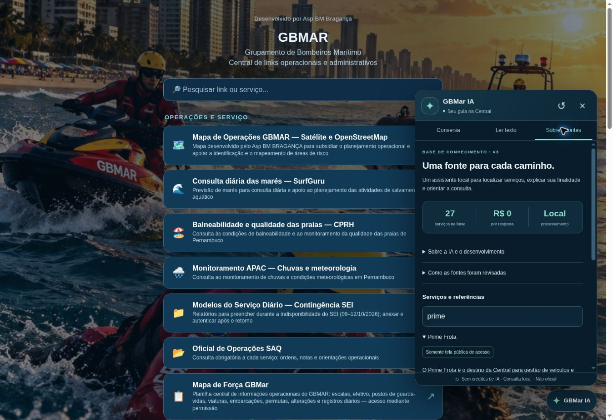

# Verificação da interface publicada — GBMar IA v3

Conferência no Chrome disponível, em 19 e 20/10/2026, no endereço público original. Versão funcional publicada no commit `0f6964c8e1439b89d2a32a5a4ba194afc60bb7f1`; execução GitHub Pages `39343048596` concluída com sucesso. A primeira tentativa sofreu HTTP 500 no serviço de publicação; a publicação subsequente funcionou.

## Resultados observados

| Verificação | Resultado |
|---|---|
| Chuva em Boa Viagem amanhã | Encaminha à previsão da APAC; distingue previsão e monitoramento; não inventa condição atual. |
| Quantos militares estão no Pina | Explica ausência de acesso ao efetivo atual e indica a planilha e a data do serviço. |
| Diferença entre mapas de força | Distingue planilha do GBMar e sistema institucional; apresenta ambos os links. |
| Senha do Prime → e-mail não chegou → fonte | Mantém Prime e informa o assessor do contrato; não promete prazo ausente da fonte. |
| “Não quero o Prime; quero o BGE” | Troca o assunto para BGE. |
| Documento sem texto fornecido | Pede o trecho; não confirma o prazo. |
| Documento sintético com 5 dias, condição e exceção | Exibe o texto literal completo, incluindo autorização, pedidos incompletos, regularização e feriados. |
| Pergunta sobre 30 dias ausentes | Informa que não localizou a expressão; não confirma o valor. |
| Ver trecho na origem | Seleciona exatamente os 224 caracteres apresentados, com linhas 1–3. |
| Filtro de fontes “prime” | Mostra a ficha Prime, público, requisitos, fonte, revisão e escopo limitado à tela pública. |
| Guia visual de acesso | A passagem do passo 1 ao passo 2 funcionou. O botão passa a se chamar “Guia de acesso” para não confundir o roteiro de entrada com a resposta específica à pergunta. |
| Vídeo da resposta de senha do Prime | Geração real de WEBM local; reprodução iniciada pelo teclado, readyState 4, 1280 × 720, sem erro de mídia. Origem blob do próprio site, sem áudio. |
| Limpar conversa e texto | Campo do documento zerado; conversa reiniciada. |
| Fechamento por Escape | Painel fecha e foco volta ao botão de abertura. |

Os erros de console vistos na sessão eram da extensão do ambiente de teste, não dos arquivos do site. A inspeção não equivale a uma captura integral do tráfego de rede.

## Telas pequenas e compatibilidade

Cinco testes automatizados conferem os limites geométricos do painel: 360×780, 390×380, 320×280, 540×300 e 375×500, incluindo redução de altura compatível com teclado virtual. CSS e ajuste com VisualViewport foram revisados. Não foi possível testar em aparelho físico, Safari ou Firefox; esta conferência não deve ser apresentada como teste real nesses ambientes.

O vídeo usa os codecs que o navegador oferece. Se faltar MediaRecorder, captureStream ou codec compatível, permanece disponível o guia visual de acesso e a resposta em texto. Os testes com APIs simuladas cobrem cancelamento, erro e liberação dos recursos. A voz depende de uma voz local disponível no aparelho; não foi comprovada nesta sessão.

## Custo e privacidade

A inspeção do código e os testes confirmam processamento local, sem clientes de API, chaves, inferência remota, telemetria ou persistência de conversas. A política `connect-src 'none'` está preservada. Os links externos só são destinos para abertura pelo visitante; suas páginas não são lidas automaticamente pelo assistente. A planilha oficial não foi alterada.

